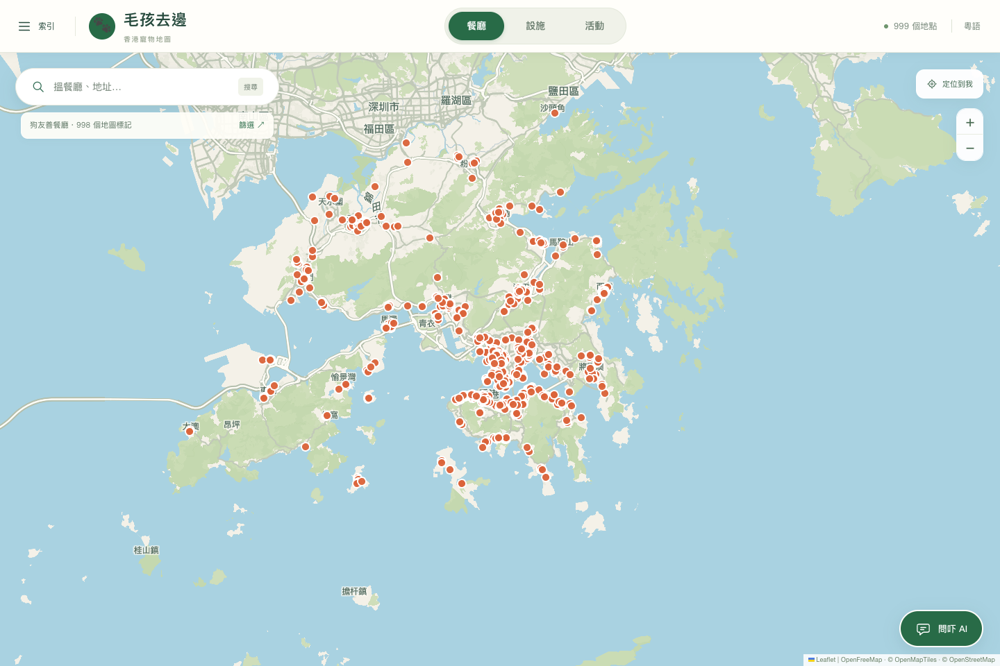

# HK PetFinder · 毛孩去邊

[繁體中文](./README.md)

**Live site: <https://hkpetmap.com>** (currently running)

A pet-friendly map for Hong Kong. Find dog-friendly restaurants, pet facilities and activities, with a bilingual interface, outing planner and an optional AI pet assistant.



## Contents

- [Features](#features)
- [Architecture](#architecture)
- [Run locally](#run-locally)
- [Configuration](#configuration)
- [Data synchronization](#data-synchronization)
- [API](#api)
- [AI assistant](#ai-assistant)
- [Development and checks](#development-and-checks)
- [License and data sources](#license-and-data-sources)

## Features

- **Map and search**: Browse restaurants, pet facilities and activities; filter by district, category, cuisine or keyword.
- **Pet facilities**: Pet parks, inclusive parks, veterinary clinics, licensed pet boarding facilities, animal management and vaccination centres, pet transport and malls.
- **Activities**: Public course and event information, with dates, locations, fees or registration links when the source provides them.
- **Parking**: Nearby government car parks and vacancy (DATA.GOV.HK; reference only, not a booking guarantee).
- **Outing planner**: Builds a plan from date, region and interests (park, vet, activity, mall, restaurant) and assigns every stop to a real car park within 1,000 m. See [docs/OUTING_PLAN.md](./docs/OUTING_PLAN.md).
- **Bilingual interface**: Traditional Chinese and English; the choice is saved in the browser. New visitors see English; `?lang=zh-Hant` is also respected.
- **Optional pet assistant**: Queries map data and public information from restricted web domains. General pet-care information only, no diagnoses or prescriptions.
- **Responsive UI**: Desktop and mobile.

## Architecture

| Directory | Contents |
| --- | --- |
| `frontend/` | Frontend (Vite + TypeScript) |
| `backend/app/` | FastAPI backend: routers, services, cache, settings, data adapters |
| `agent/data/` | Data interface: map data access, search, nearby-restaurant answers, tool functions and the local MCP server |
| `agent/assembly/` | Main-agent assembly: prompts, model client pool, `run_pet_assistant` |
| `agent/memory/` | Conversation memory (short-term, keyed by `session_id`) |
| `agent/subagents/` | Sub-agents: intent classifier, answer reviewer, restricted web research, trip stop selector |
| `scripts/` | Dev launcher, data sync and photo scripts |
| `data/` | Data snapshots |
| `docs/` | Documentation and screenshots |

The web server only reads published snapshots; a separate sync process updates upstream data.

## Run locally

Requires Python 3.12+, Node.js and npm. The map works without an AI API key.

```bash
python3 -m venv .venv
.venv/bin/python -m pip install -e '.[dev]'
npm --prefix frontend ci
cp .env.example .env
bash scripts/dev.sh
```

Frontend: <http://127.0.0.1:5174/>. FastAPI docs: <http://127.0.0.1:8001/docs>.

If you already have a `.env`, do not overwrite it with the example.

## Configuration

Settings come from `.env` (see [.env.example](./.env.example)). Keys are read only by the backend.

| Variable | Purpose |
| --- | --- |
| `BAI_API_KEY` / `BAI_BASE_URL` / `BAI_MODEL` | Main assistant credentials and endpoint; without valid credentials the map still works but the assistant does not |
| `MAIN_REASONING_EFFORT` | Main assistant reasoning effort; blank omits the parameter |
| `INTENT_MODEL` / `INTENT_CONFIDENCE_THRESHOLD` / `INTENT_TIMEOUT_SECONDS` | Intent classifier (no fallback; failures are rejected) |
| `WEB_SEARCH_*` | Web research sub-agent; blank key/base URL reuse `BAI_*` |
| `AGENT_TOOL_TRANSPORT` | Tool transport: `function` (default) or `mcp_stdio` |
| `CHAT_RATE_LIMIT` / `CHAT_RATE_HARD_LIMIT` / `CHAT_RATE_WINDOW_SECONDS` | Chat rate limits: above the soft limit requests use `FALLBACK_MODEL`; above the hard limit they get 429 |
| `LLM_MAX_CONCURRENCY` / `LLM_FALLBACK_CONCURRENCY` / `LLM_QUEUE_TIMEOUT_SECONDS` | Per-process model concurrency and queue timeout |
| `REDIS_URL` / `CACHE_PREFIX` | Optional Redis cache |
| `CORS_ORIGINS` | Allowed origins; the API also accepts `https://hkpetmap.com` and `https://www.hkpetmap.com` by default |
| `PET_SNAPSHOT_PATH` / `SNAPSHOT_POLL_SECONDS` / `SYNC_CHECK_SECONDS` / `SNAPSHOT_MAX_AGE_SECONDS` | Snapshot location, polling and sync intervals |

Without Redis the app uses an in-process cache, which is not shared between processes. The default shared sync lock requires Redis; use a file lock for single-machine development.

## Data synchronization

The web server never fetches upstream data when visitors open or query the site. To refresh data:

```bash
.venv/bin/python -m scripts.sync_data --lock file
```

Add `--geocode` to resolve missing addresses. A periodic sync worker can run on a single machine:

```bash
.venv/bin/python -m scripts.sync_worker --lock file
```

For multi-host deployments use a Redis shared lock and run only one worker:

```bash
.venv/bin/python -m scripts.sync_worker
```

To start the worker together with the frontend and backend in development:

```bash
PET_START_SYNC_WORKER=1 PET_SYNC_LOCK_MODE=file bash scripts/dev.sh
```

If a source fails, its last successful data is kept; places without coordinates are never placed at estimated locations. The sync interval is this project's update policy, not an upstream promise.

## API

All paths are prefixed with `/api/v1`; interactive docs are served locally at `/docs`.

| Method | Path | Purpose |
| --- | --- | --- |
| `GET` | `/health` | Health check |
| `GET` | `/catalog` | Categories, cuisines and source status |
| `GET` | `/places` | Search restaurants or facilities |
| `GET` | `/places/{place_id}` | Place details |
| `GET` | `/activities` | Search activities |
| `GET` | `/parking` | Nearby car parks and vacancy |
| `GET` | `/plans/options` | Planner regions and destinations |
| `POST` | `/plans` | Build an outing plan |
| `GET` | `/assistant/capabilities` | Assistant capabilities and tools |
| `POST` | `/assistant/prefill` | Warm the nearby-restaurant answer after location sharing |
| `POST` | `/assistant/chat` | Assistant chat |
| `POST` | `/assistant/chat/stream` | Streaming assistant chat (SSE) |

Restaurant/facility photo endpoints (`/restaurant-photos/…`, `/facility-photos/…`, `/restaurant-dish-photos/…`) also exist. Chat and plan endpoints are rate limited.

## AI assistant

A chat request passes through:

1. **Intent classification** (`subagents/intent_router`): intent and confidence; out-of-scope requests are refused, low confidence asks for clarification, and classifier failures never pass through.
2. **Routing**: identity questions are answered directly; web research goes to a restricted sub-agent; everything else goes to the main agent.
3. **Main agent** (`assembly/service`): read-only data tools (function tools or local MCP stdio) plus the web research tool; supports streaming.
4. **Answer review** (`subagents/answer_guard`): checks relevance, scope and that the current request is addressed; a failed review withholds the answer.
5. **Memory** (`memory/conversation`): with a `session_id`, keeps the last 5 messages for 10 minutes.

Model concurrency is capped; overflow degrades to a lightweight model, and a saturated service returns 503. Web research searches only allow-listed domains and verifies citations. The assistant offers no booking, payment, login, route or travel-time estimates, and no arbitrary web access. Pet-health content is for general care and veterinary triage only, not diagnosis, prescriptions or dosing.

Start the MCP stdio server:

```bash
.venv/bin/python -m agent.data.mcp_server
```

## Development and checks

```bash
.venv/bin/python -m pytest -q
npm --prefix frontend run build
npm --prefix frontend run check:i18n
npm --prefix frontend run check:language
```

The frontend production build writes `robots.txt`, `sitemap.xml`, and static category, district and place pages to `frontend/dist`. Deploy the complete `frontend/dist` directory.

Tests cover the API, source parsing, snapshot sync, the outing planner and the agent chain (intent routing, review, web research, rate-limit degradation).

## License and data sources

- Source: [GitHub](https://github.com/sammyliao1146-ship-it/hkpetmap); software license: [MIT License](./LICENSE).
- Upstream data, basemap tiles and third-party photos are not covered by the MIT license; follow each provider's terms. See [Data source notes](./docs/DATA_SOURCES.md).
- Official lists and manual additions may overlap and do not represent a complete count for Hong Kong. General parks may not allow pets, and restaurant admission rules vary by venue. Confirm current rules with the venue or service provider.
